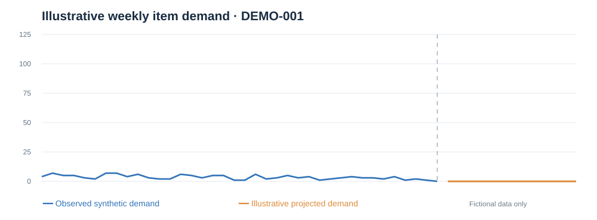

# Retail Forecast Lab

A **portfolio-ready, standalone demonstration** of weekly SKU-level demand forecasting using **fictional retail data**. Built to illustrate how product leadership, statistical forecasting, planner decision support and validation can work together.

> **Public-data safety:** This repository intentionally contains no employer datasets, retailer-specific business rules, internal identifiers, system names, private credentials, or direct warehouse connections. It is an independent educational example, not a production migration or a claim that these parameters are tuned for a particular retailer.



## Capabilities

- **Input validation:** Standardized `item_id`, `week_ending`, `units` CSV input; preserves leading zeros in item IDs.
- **Data-quality checks:** Detects missing reporting weeks, malformed dates, negative quantities and empty inputs.
- **Aligned horizons:** All SKU forecasts start after the same observed reporting week.
- **Transparent models:** Weighted recent average and exponentially weighted level + damped trend; pooled seasonal adjustment when sufficient history exists.
- **Walk-forward backtests:** Each prediction is made using only data available before its target week. Compares WAPE and signed bias by item and method.
- **Model selection:** Selects the lower-error method from an historical evaluation window, with clear caveats about selection bias.
- **Business controls:** Optional inactive-product exclusion, configurable horizon and reproducible run metadata.
- **CSV outputs:** Weekly forecast, detailed backtest, item-method scorecard, run configuration/limitations.
- **Reproducible demonstration:** Deterministically generated synthetic retail sales plus automated tests and GitHub Actions CI.

## Quick start

```bash
python -m venv .venv
source .venv/bin/activate  # Windows: .venv\\Scripts\\activate
python -m pip install -e '.[dev]'
python scripts/generate_sample_data.py
retail-forecast --input data/synthetic_weekly_sales.csv --output-dir outputs --horizon 12
python -m pytest -q
```

Outputs will appear in `outputs/`:

| File | Description |
|---|---|
| `forecasts.csv` | Item/week forecast, cumulative units, selected method |
| `backtest_detail.csv` | Expanding-window one-week-ahead actuals, predictions and errors |
| `backtest_scorecard.csv` | WAPE and signed bias by item and candidate method |
| `run_info.json` | Forecast anchor, settings, validation counts and limitations |

### Example input

```csv
item_id,week_ending,units
DEMO-001,2025-01-03,28
DEMO-001,2025-01-10,33
DEMO-002,2025-01-03,14
DEMO-002,2025-01-10,19
```

Pass **at least 8 weeks of history** for model scoring, and ideally 78+ weeks to activate the pooled seasonal index. All `week_ending` dates must represent Fridays. The provided synthetic dataset has adequate history for a full demonstration.

### CLI options

```bash
retail-forecast --help
retail-forecast \
  --input data/synthetic_weekly_sales.csv \
  --output-dir outputs \
  --horizon 20 \
  --backtest-weeks 8 \
  --inactive-after 8
```

Use `--cutoff YYYY-MM-DD` for a historical forecast origin and `--no-seasonality` to disable pooled seasonal adjustments.

To regenerate the chart after running the demo, install the optional `viz` extra (`python -m pip install -e ".[viz]"`) and run `python scripts/plot_demo.py`.

## Design overview

```text
Synthetic weekly sales CSV
            |
            v
  Validate and align SKU history
            |
            +----> Expanding-window backtest ---> Compare model errors
            |                                           |
            v                                           v
  Weighted-average or damped-trend forecast <--- Select per-item model
            |
            v
  Common weekly forecast horizon
            |
            v
  CSV forecasts + backtest scorecard + metadata
```

### Important modeling assumptions

This is an intentionally transparent **baseline** suitable for explanation and demonstration, not a vendor-grade forecasting engine.

1. Missing item-week records **after the first recorded week** are interpreted as zero sales. This assumption is unsafe for incomplete feeds and should be changed for actual production data.
2. The project uses **observed unit sales**, which may understate demand during stockouts. It does not estimate lost sales.
3. Seasonality is learned at the **pooled assortment level**, not by category, brand, location or channel. Items with unusual seasonality may need other approaches.
4. Model selection and reported backtest errors use the same historical evaluation window. For rigorous prospective accuracy claims, reserve a separate untouched test period.
5. WAPE and signed bias have limitations when actual demand is near zero; outputs use null ratios when the denominator is zero.
6. This demo does not include causal promotion effects, pricing, product attributes, lead times, returns, new-item cold starts, inventory optimization, or probabilistic demand intervals.
7. Forecasts must be evaluated against the business outcome, not accuracy alone: stock availability, inventory investment, markdowns and working capital matter too.

## What this project demonstrates

This project illustrates a cross-functional forecasting-product pattern:

- Surface meaningful forecast candidates to planners.
- Let the evaluation method be transparent and testable.
- Track errors and bias rather than treating model deployment as the finish line.
- Tie future extensions to decision support and inventory outcomes.

**Possible extensions:** planner overrides with reasons and outcome monitoring, category-specific model selection, censored-demand handling for stockouts, SKU analogs for cold starts, and cost-aware inventory decision simulations.

## Publishing and ownership

The uploaded internal script is **not included**. This repository contains a new generic demonstration built from widely understood forecasting concepts and **synthetic data only**. Nevertheless, if the original work was developed during employment, confirm your confidentiality/IP obligations before publicly publishing any derivative work or discussing employer-specific implementations. Do not upload real transaction data or the original file. No software license has been assigned here; add one only when you have the rights to do so.